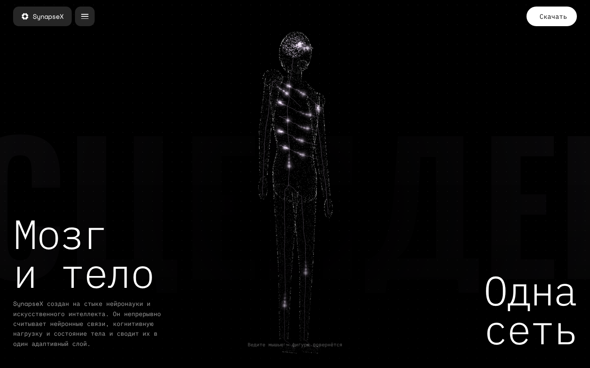

# SynapseX

Одностраничный лендинг нейроинтерфейса SynapseX. React + TypeScript + Vite + Tailwind CSS + Framer Motion.



## Запуск

```bash
npm install
npm run dev      # локально на http://localhost:5173
npm run build    # сборка в dist/
npm run preview  # проверить собранную версию
```

## Деплой

**Vercel:** vercel.com → Add New → Project → выберите этот репозиторий → Deploy. Настройки определятся сами (Framework: Vite, Build: `npm run build`, Output: `dist`).

**Netlify:** app.netlify.com → Add new site → Import from Git → этот репозиторий. Build command `npm run build`, publish directory `dist` (уже указаны в `netlify.toml`).

## Что где менять

| Что | Где |
| --- | --- |
| Ссылки на фоновые видео | `src/lib/media.ts` → `VIDEOS` |
| Ссылка кнопки «Скачать» | `src/lib/media.ts` → `DOWNLOAD_URL` |
| Фигура человека в первом экране | `src/components/NeuralHuman.tsx` |
| Тексты секций | `src/sections/*.tsx` |
| Мета-теги и превью для соцсетей | `index.html`, `public/og.png` |

## Шрифты

Space Mono и Anton SC не содержат кириллицы, поэтому русские буквы рисуются близкими по характеру IBM Plex Mono и Oswald. Латиница и цифры остаются в Space Mono / Anton SC.
